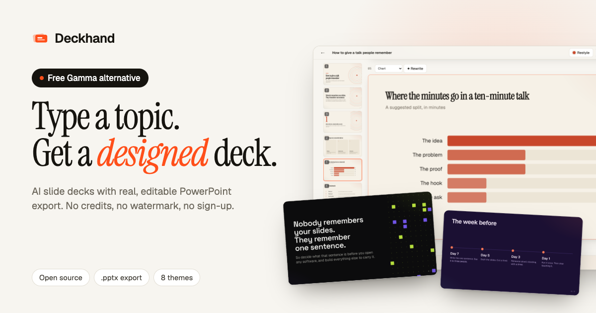
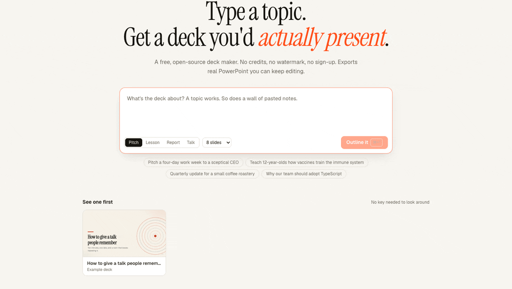
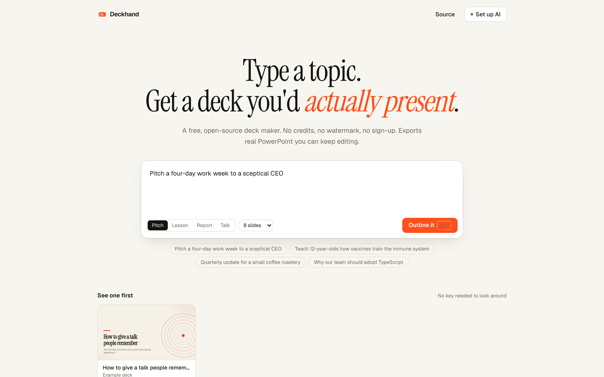
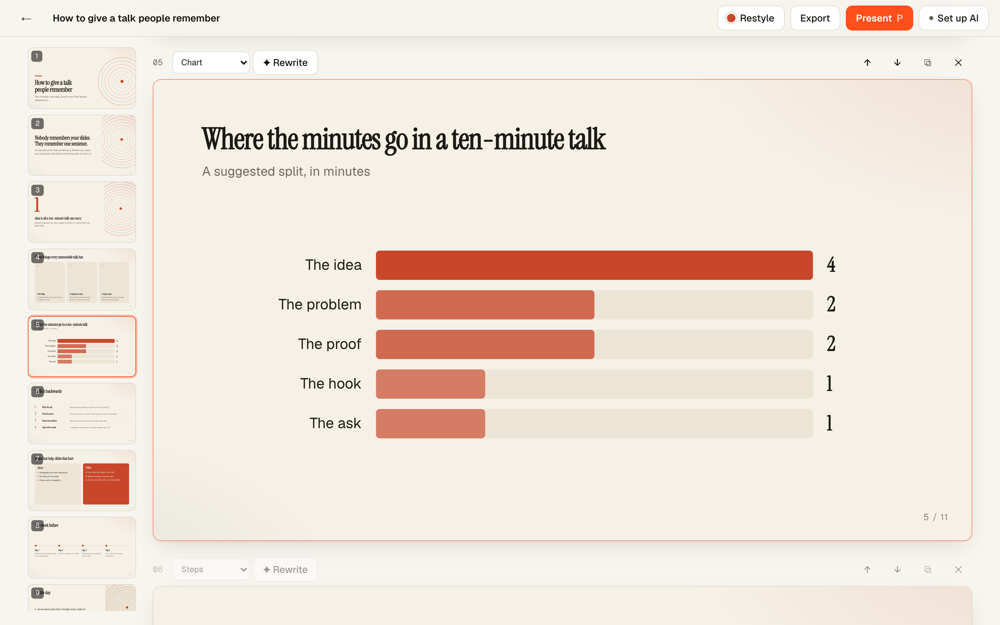
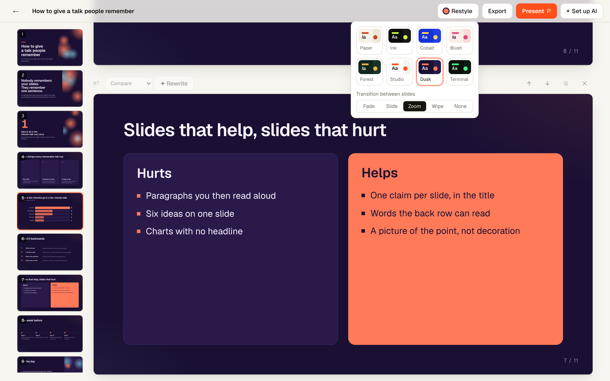
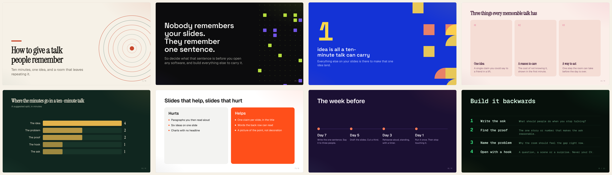
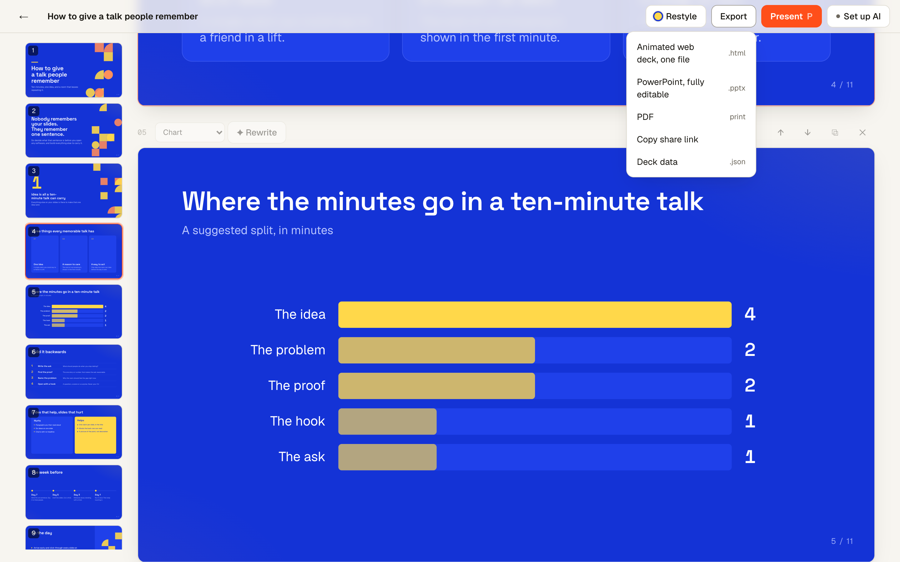
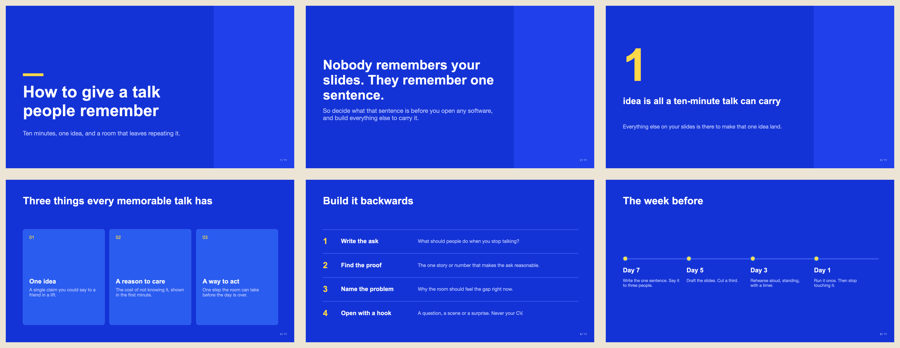
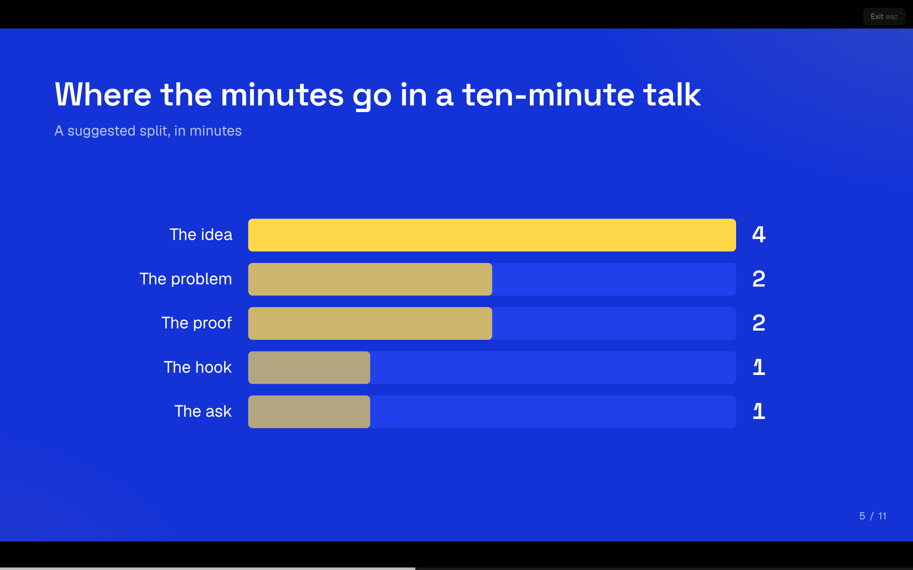
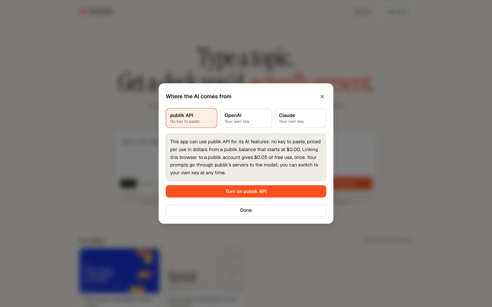

<p align="center"></p>

# Deckhand

**Type a topic, get a designed slide deck, and export it as real, editable PowerPoint. Free and open source.**

[Open Deckhand](https://deckhand-dusky.vercel.app) · [Deckhand on Publik](https://publikhq.com/deckhand) · MIT licensed

<p align="center"></p>

<p align="center"><sub>The live app: open the example deck, restyle it through four themes, open Export. No model call in this clip.</sub></p>

| | |
|---|---|
|  |  |
| **Start from a topic or pasted notes.** Pick a kind of deck and a length. | **Edit anything.** Switch a slide's layout, reorder, or ask the AI to rewrite one slide. |
|  |  |
| **Restyle in one click.** Eight themes and five slide transitions. | **Thirteen layouts.** The same deck's slides, each shown in a different theme. |
|  |  |
| **Export.** PowerPoint, one-file animated HTML, PDF, or a share link. | **Real PowerPoint.** The exported `.pptx`, rendered by macOS Quick Look. Text and shapes are native objects. |
|  |  |
| **Present** full screen, straight from the browser. | **Pick where the AI comes from.** publik API, or your own OpenAI or Anthropic key. |

<sub>Every screenshot is the live app at deckhand-dusky.vercel.app. The deck shown is the built-in example deck, which is hand-written and ships with the app; it was not generated by a model for these images. Dark mode is supported too ([screenshot](docs/media/01-home-dark.png)).</sub>

## What you get

- **No credits, no watermark, no sign-up.** Decks are saved in your browser.
- **Real PowerPoint export.** Titles, bullets, cards and charts are native, editable objects, not pictures of slides.
- **Thirteen layouts, eight themes.** Stats, timelines, comparisons, charts, quotes, big numbers. Restyle the whole deck in one click.
- **It moves.** Slides build in with staggered motion, numbers count up, bars grow, and you pick the transition between slides.
- **Your deck as code.** Export one self-contained, animated `.html` file that plays in any browser.
- **Edit anything.** Click any text to change it, switch a slide's layout, or ask the AI to rewrite one slide.
- **Share by link.** The whole deck is packed into the URL; nothing is uploaded.
- **Bring any model.** publik API (no key to paste), your own OpenAI or Anthropic key, or any OpenAI-compatible endpoint such as OpenRouter or Ollama.

## Compared with Gamma

Gamma is the polished, paid option and does more. Deckhand is for people who want a free, open deck maker with real PowerPoint export and their own choice of model. Gamma details are from [gamma.app/pricing](https://gamma.app/pricing), checked November 10, 2026.

| | Deckhand | Gamma |
|---|---|---|
| Price of the app | Free, MIT licensed | Free plan; Plus $12/mo ($9/mo billed yearly); Pro $25/mo ($18/mo yearly); Ultra $100/mo ($90/mo yearly) |
| What the AI costs | Pay per use from a publik balance (starts at $0.00; linking a publik account adds $0.05 once), or your own OpenAI or Anthropic key billed by them | 400 credits at signup on Free; 1,500 to 20,000 monthly credits on paid plans |
| Account needed | No | Yes |
| Gamma or Deckhand branding | None | Removing Gamma branding is listed as a Plus feature |
| PowerPoint export | Yes, native editable text, shapes and charts | Yes, on every plan |
| Other exports | PDF, one-file animated HTML, JSON, share link | PDF, PNG, Google Slides |
| Choice of model | publik API, your own OpenAI or Anthropic key, or any OpenAI-compatible endpoint (OpenRouter, Ollama) | Gamma's built-in models |
| AI images | No, artwork is generative and drawn from the theme | Yes |
| Collaboration, cloud workspace | No, decks live in your browser | Yes |
| Docs, websites, custom domains | No, slide decks only | Yes |
| Source code | Open | Closed |

## Run it

```bash
npm install
npm run dev
```

Open http://localhost:3000, click **Set up AI**, and paste an OpenAI or Anthropic API key. Own keys stay in your browser and go straight to the provider; they never touch the server.

To offer publik API to your visitors, copy `.env.example` to `.env.local` and set `PUBLIK_APP_TOKEN`.

```bash
npm run build && npm start            # production
npm run build && PUBLIK_SELF_TEST=1 npm start   # prove the publik wiring, then exit
```

## How it works

1. **Outline.** The model plans the deck as one JSON object per line: a title and a one-sentence gist for each slide. You edit the plan before anything is built.
2. **Slides.** The model writes each slide as one line of JSON, choosing from thirteen layout shapes. A tolerant line parser renders every slide the moment its line completes, so cards appear while the rest is still being written.
3. **Render.** Slides are drawn on a fixed 1280×720 canvas from theme tokens, so restyling never touches content and print, present and export all match.

Slide JSON is normalised before it is drawn (`lib/parse.ts`), so a weaker model's sloppy output still produces a valid deck.

## Limits, honestly

- No images yet: artwork is generative and drawn from the theme.
- No accounts or collaboration. Decks live in one browser unless you share a link or export.
- PowerPoint export uses system fonts, so type differs slightly from the web view.
- The model can be wrong. The prompts forbid invented statistics, but check any number before you present it.

## Stack

Next.js (App Router), TypeScript, Tailwind, pptxgenjs. MIT licensed.
